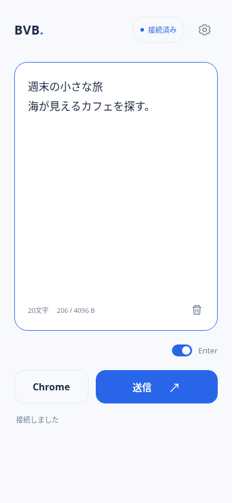
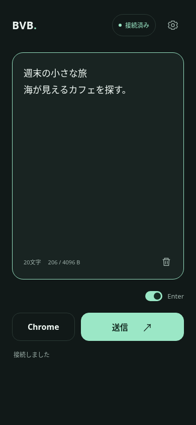

# 共同レビュー用の成果案内

COFEN1005さん向けに、Chrome起動・検索対応の成果と確認方法をまとめています。

- 共同作業先のPR：**[COFEN1005/BVB #1](https://github.com/COFEN1005/BVB/pull/1)**
- 成果ブランチ：[nishida0802/BVB / feat/chrome-search-bridge](https://github.com/nishida0802/BVB/tree/feat/chrome-search-bridge)
- 操作・設定：[README](../README.md)
- 実施済みの検証と実機チェック表：[検証記録](verification.md)
- 通信の詳細：[プロトコルv2](protocol.md)

## 実装した動作

「Chrome」は入力欄の本文を送らず、USBキーボード操作でChromeを呼び出します。「送信」はChromeを呼び出した後、Google検索URLをアドレスバーへ入力します。検索URLはスマホ側で日本語・記号・絵文字を一度だけエンコードし、改行は空白にします。Enter OFFではURLを残します。

主画面をライト（白と青）／ダーク（ダークとミント）に整理しました。OS・PC配列・テーマ・合言葉・待機時間を設定へまとめ、保存します。対象PCは明示選択し、スマホのOSから推定しません。

初期の合言葉は「クロームを開いて」です。入力欄全体の一致、入力の1200 ms安定待ち、変換中の除外、同じ入力の重複防止を行います。標準キーボードの音声入力を使います。発話終了をWeb側で確実には取得できないため、途中の長い間で発火する可能性があります。

従来のAlt+X入力を設定内に残し、Chrome検索とは分離しました。mainの`9d6814a`にあるIME OFF修正は、Windowsの従来入力に非ASCII文字が含まれる場合のHID LANG2として引き継ぎ、競合を解消しています。

利用時は **iPhone / Bluefy → BLE → ESP32-S3 → ネイティブUSB HID → PC** の構成です。PCに補助ソフトを追加する必要はありません。iPhoneでは引き続きBluefyが必要です。

## 画面プレビュー

以下はLinux Chromiumで取得した390×844の画面です。接続済み表示はGATTモックによるテスト表示です。

| ライト | ダーク |
| --- | --- |
|  |  |

設定画面：[ライト](screenshots/light-settings.png) / [ダーク](screenshots/dark-settings.png)

## 最初の確認手順

1. [成果ブランチ](https://github.com/nishida0802/BVB/tree/feat/chrome-search-bridge)を取得します。既存のローカル作業がある場合は保持し、別の作業ディレクトリで確認してください。
2. `firmware/BVB_ESP32S3`のスケッチと同じフォルダ内のヘッダーを一緒に開き、**Ozobot DRVKit / Arduino-ESP32 3.3.12**、USB-OTG（TinyUSB）でビルド・書き込みします。このボードのUSB Mode初期値（Hardware CDC and JTAG）から変更してください。[詳細設定](../README.md#配信とファームウェアのビルド)
3. 同じブランチの`dist`をHTTPSで配信します。既存のRenderサイトを使う場合は、配信元ブランチの設定変更が必要です。PR作成やpushだけでは公開サイトに反映されません。
4. PCをロック解除し、Chrome導入、英数入力、Caps Lock OFF、標準の起動ショートカットを確認します。ESP32-S3のネイティブUSBをPCへ接続します。
5. iPhoneのBluefyで配信先を開き、設定で対象PC（Windows / Mac）と配列（US / JIS）を選択・保存します。接続状態のボタンから`ESP-BVB Bridge`に接続します。
6. 空欄で「Chrome」を押し、PC側でChromeが前面に来るかを確認します。次にEnter OFFで短文を送り、URLがアドレスバーに入るか目視します。
7. Enter ONで検索実行を確認します。日本語・英数字・空白・記号`:/?=%`・絵文字・改行、Chrome未起動／起動済みを[実機チェック表](verification.md#実機チェック手順)に沿って確認してください。

Webとファームウェアは両方更新してください。旧ファームウェアへ新操作を誤送信しないよう、能力確認が成功するまで操作を無効にしています。

## 検証状況とレビュー時の注意

- Node.jsテスト18件、Playwright画面テスト17件、C++のプロトコル・HID操作列・中断テストが成功しています。最新のOzobot DRVKit / Arduino-ESP32 3.3.12への更新時に、Node.js・C++テストと対象ボードのビルドを再実施し、成功しています。
- 画面の両テーマを目視し、320 / 768 / 1280 pxで横はみ出しがないことを確認しました。
- **ESP32-S3実機、iPhone / Bluefy、実際のMac / Windowsでの動作は未確認です。** BLEの自動テストはモックです。HID送出完了は、PC側のChrome起動・検索成功の確認ではありません。
- US / JISの記号のHIDキー対応はコードで照合しましたが、実際のPC配列・IMEと合わせた出力確認が必要です。起動やフォーカスが遅いPCでは設定の待機時間を増やしてください。
- 指定参考画像`bvb-ui-simple-v2.png`は未提供のため、画像そのものとの一致は未確認です。

初回成果はPR #1を経て共同作業先のmainに取り込まれています。今回のOzobot DRVKit / Arduino-ESP32 3.3.12向け設定変更は、上記の成果ブランチ・ZIPから取得してください。サイトの公開設定変更はこの作業では行っていません。
